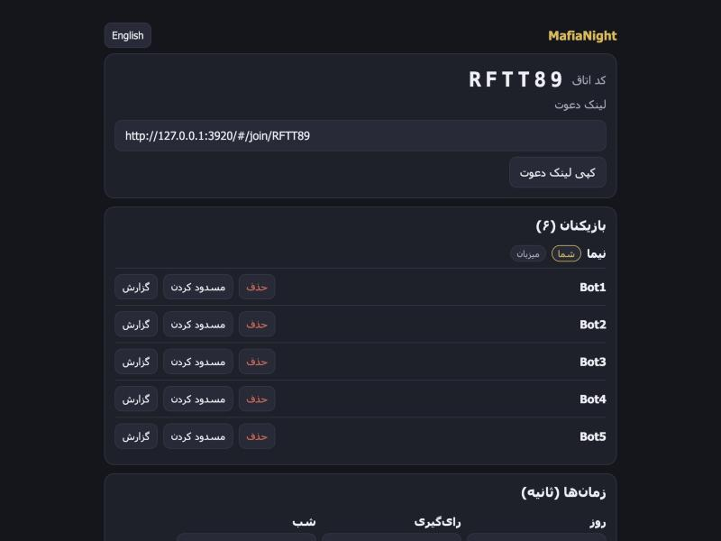

# MafiaNight (working name)

Mafia (bazie Mafia) is a party game where a hidden minority tries to eliminate everyone else, and the rest try to find them by talking and voting. This project lets you play it online, in a browser, with nothing to install. The app is the moderator, so everyone gets to play.

It works in Farsi (right to left) and English, and it's built phone first.

**Status:** a working prototype that runs and is tested on one machine. It has not been run on a public server yet. Built-in voice is a fake for now, see the table below.

"MafiaNight" is only a working name and it will probably change.



## What it does

You open the page, pick a nickname and create a private room. You share the link, friends join, and the host starts. The app deals the roles in secret and runs the game.

- Roles: Citizen, Doctor, Detective, Mafia, Godfather. The rules are in [docs/RULES.md](docs/RULES.md).
- 6 to 12 players, no accounts
- Day chat, a private Mafia chat at night, voting with a tie rule
- Reconnect after a dropped connection, and games survive a server restart
- Report, block, host kick, and a tool for reviewing reports
- Games and chat are deleted 24 hours after a game ends. No phone numbers, real names, recordings or analytics.

## Quick install

You need Node 24 or newer. There are no npm dependencies, so there is nothing to install besides Node.

```bash
git clone https://github.com/abozaralizadeh/MafiaNight.git mafianight
cd mafianight
npm start
```

Open http://127.0.0.1:3000 and create a room. A game needs six players. To try one alone, add random bots to your room with its code:

```bash
npm run bots -- ROOMCODE 5
```

Settings are environment variables. Copy `.env.example` to `.env` to change them. It lists every one, and none of them is a secret.

## Tests

```bash
npm test
```

About 90 tests, around 25 seconds. They include a full game played over the real network connection that checks no player ever receives another player's secret role.

Other scripts:

```bash
npm run simulate         # plays thousands of random games and prints win rates
npm run load -- 50 12    # 50 rooms of 12 bots at once, with timings and memory
```

The simulator's players vote at random, so its win rates say nothing about real balance.

## What is real and what is faked

| Area | State |
| --- | --- |
| Rules engine, rooms, chat, timers, reconnect, restart recovery | Real, tested |
| Browser app in Farsi and English | Real. Checked by hand at desktop and phone width, not yet on real phones. |
| Voice | **Faked.** There is a voice interface (`src/voice/provider.js`) and a local fake that carries no audio. The server decides who may speak and the app shows it, but no sound is sent. Set `VOICE_PROVIDER=fake` to see the panel. |
| Hosting and HTTPS | `setup_service.sh` is written and syntax checked. It has not been run on a real VM yet. |
| Privacy and terms pages | Short drafts, not reviewed by a lawyer |
| Farsi wording | A first draft that needs a native review |
| Fonts | System fonts. No Farsi web font is bundled yet. |
| Nickname word list | Empty on purpose. It needs native speakers. |

The full list of what is left is in [docs/ROADMAP.md](docs/ROADMAP.md).

## Run it on a Linux server

```bash
sudo ./setup_service.sh
```

On the first run it installs Node, creates a service user and a systemd service, and starts it. Run it again to update and restart. Add `DOMAIN=play.example.com` to put Caddy in front for HTTPS. It also sets up a daily database backup and a health check that runs every minute.

Logs: `journalctl -u mafianight.service -f`. A size-limited file log is in `logs/` next to the app. Logs never contain chat text, roles, nicknames or addresses.

## Debugging in VS Code

`.vscode/launch.json` has "Backend: server", "Backend: tests" and "Frontend: Chrome", plus a "Server + Browser" combination that starts the server and Chrome together.

## Docs

| File | What's in it |
| --- | --- |
| [docs/RULES.md](docs/RULES.md) | The rules in full |
| [docs/DESIGN.md](docs/DESIGN.md) | Architecture, the HTTP API, the data model |
| [docs/LOGICAL-FLOW.md](docs/LOGICAL-FLOW.md) | Main flows with diagrams |
| [docs/ROADMAP.md](docs/ROADMAP.md) | What works and what is left |

## Contributing

Issues and pull requests are welcome once the repository is public. A few things to know first:

- Run `npm test` before you open a pull request, and add a test for what you change.
- The rules engine in `src/engine/` stays pure: no clock, network, database or randomness of its own.
- Everything a player receives goes through `src/server/view.js`. If you add a field to a view, extend the leak tests in `test/server.test.js` and `test/units.test.js`.
- The browser app never builds HTML from strings and uses no inline styles. CSS uses logical properties only, so right to left keeps working. Tests check these.
- Keep the data minimal. No names, phone numbers, recordings, or chat text and roles in logs.
- No new dependencies without a good reason. Staying dependency free is a feature.

## License

To be decided. Until a license file is added, all rights are reserved.
