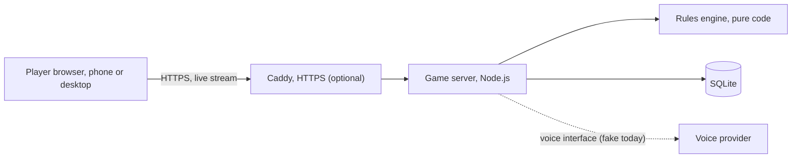
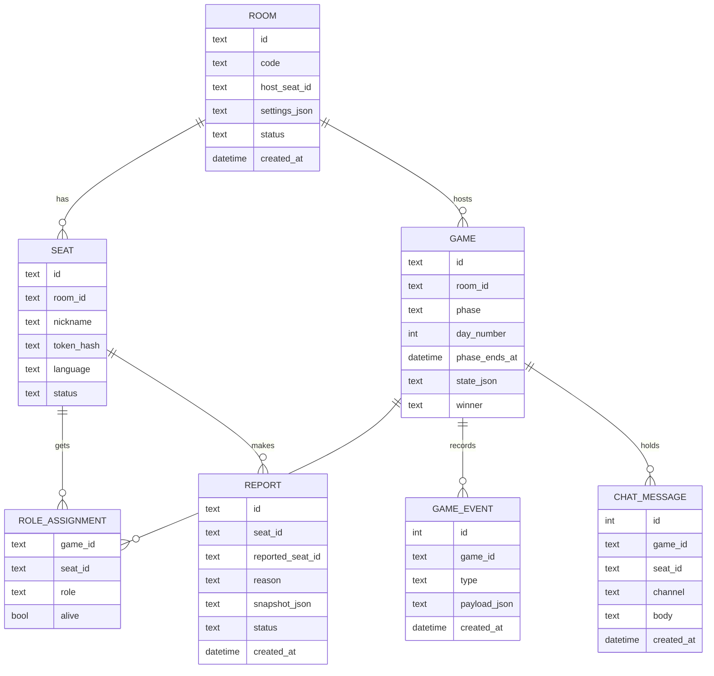

# Design

How the game is built. The rules are in [RULES.md](RULES.md) and the main flows are in [LOGICAL-FLOW.md](LOGICAL-FLOW.md).

## Architecture

One server process, one SQLite file. Browsers talk to it over HTTP and a live stream. Voice is an interface with a local fake, so a real voice server can be added later.

The parts:

- **Web client:** shows the view it's given and sends what the player does. It holds no secrets.
- **Game server:** rooms, connections, timers, chat. It keeps live games in memory and saves each change.
- **Rules engine:** takes a game state and an action and returns the new state plus events. No network, database, clock or randomness inside.
- **View filter:** turns the full game state into what one player may see. Every message to a client goes through it.

## Stack

| Part | Choice | Why |
| --- | --- | --- |
| Language | JavaScript modules | No compile step, nothing to install. Types can be added later. |
| Web client | Plain JS modules, no framework | Small enough not to need one. Text is always set with `textContent`, so chat cannot inject markup. |
| Server | Node's built-in `http` | No dependencies at all. |
| Real time | A live stream over HTTP (Server-Sent Events, read with `fetch`) plus JSON posts | The game only needs the server to push. The session token goes in an `Authorization` header, never in a URL. The client reconnects by itself. |
| Database | `node:sqlite`, built into Node 24 | No dependencies. Node still marks it experimental, so the scripts hide that one warning. Check it on each Node upgrade. |
| Tests | `node:test` and a stream client that talks to a real server | There is no automated browser test yet. |
| Translations | Two plain dictionaries (Farsi, English), with tests that keys and placeholders match | Enough for two languages. |
| Styling | CSS logical properties only, enforced by a test | Right to left works without a second layout. |
| Font | Vazirmatn, one variable file served by the app | Reads well in Farsi and English, works offline, no outside font service. |
| HTTPS | Caddy, set up by `setup_service.sh` when `DOMAIN` is given | Handles certificates by itself. |
| Voice | An interface in `src/voice/provider.js` and a local fake | The fake carries no audio. See below. |

### How the parts connect

- `src/engine/rules.js`: the pure rules engine. State in, state out.
- `src/server/view.js`: the only place game state is turned into something a player receives. Tests prove another player's role, night choices and token never appear.
- `src/server/rooms.js`: rooms, seats, timers, chat, reports, retention and restart recovery.
- `src/server/store.js`: SQLite tables and the purge that enforces the retention table.
- `src/server/http.js`: the HTTP API, the live stream, static files and security headers.
- `src/voice/`: `policy.js` decides who may speak now. `provider.js` is the interface plus the fake.
- `src/config.js`: every setting, read from the environment. `.env.example` lists them all.

### Voice

The server decides who may speak: nobody at night or during votes, one living player at a time by day (turns use at most 70% of the day), then open discussion for the living, and everyone after the game. It tells the voice provider with `setSpeakers`. The only provider is the fake, which records those calls and carries no audio, so the "Voice" panel in the app shows whose turn it is and says plainly that voice is simulated. A real provider needs a real voice server and is not built yet.

### HTTP API

| Call | What it does |
| --- | --- |
| `POST /api/rooms`, `POST /api/rooms/:code/join` | Make or enter a room. Return a session token. |
| `GET /api/stream` | The live stream of this player's filtered view. |
| `GET /api/view` | One filtered view, for checks. |
| `POST /api/start`, `/api/rematch`, `/api/settings`, `/api/kick` | Host tools. |
| `POST /api/action` | `{ "type": "night" \| "vote" \| "ready", "target": seatId }`. |
| `POST /api/chat` | `{ "channel": "public" \| "mafia", "text": "..." }`. |
| `POST /api/leave`, `/api/block`, `/api/report` | Player safety tools. |
| `GET /api/voice` | Voice join details. 404 when voice is off. |
| `GET /api/admin/reports`, `POST /api/admin/reports/:id` | Review tools. 404 unless `ADMIN_TOKEN` is set. |
| `GET /api/config`, `GET /api/health` | Public settings and a health check. |

### Notes on the data

- Roles and the whole game state live in `games.state_json`, so there is no separate role assignment table.
- `game_events` holds public events only (night results, vote results, winner).
- `bans` holds hashed session tokens and `totals` holds games played, wins and player count, with no personal data.
- Tokens are stored only as SHA-256 hashes.
- A ban is only as strong as a session token. Joining always issues a new token, so a banned browser can come back as a new player. A stronger ban needs accounts or a stored address or device id, which this project avoids on purpose. Ban records are dropped after 90 days.
- Night early end is off by default, see [RULES.md](RULES.md).

## Rule set for v0.1

A simple start, with numbers to adjust after real games. The full rules with every edge case are in [RULES.md](RULES.md).

| Role | Team | Can do |
| --- | --- | --- |
| Citizen | Citizens | Talk and vote |
| Doctor | Citizens | Saves one person each night, themselves only once per game |
| Detective | Citizens | Checks one person each night |
| Mafia | Mafia | Knows the team, helps pick the target |
| Godfather | Mafia | Picks the target, reads as not Mafia to the Detective |

| Players | Mafia side | Doctor | Detective | Citizens |
| --- | --- | --- | --- | --- |
| 6 | 2 | 1 | 1 | 2 |
| 7 | 2 | 1 | 1 | 3 |
| 8 | 2 | 1 | 1 | 4 |
| 9 | 3 | 1 | 1 | 4 |
| 10 | 3 | 1 | 1 | 5 |
| 11 | 3 | 1 | 1 | 6 |
| 12 | 4 | 1 | 1 | 6 |

The Mafia side is always one Godfather plus Mafia players.

Default timers: day 3 minutes, vote 45 seconds, night 45 seconds. The host can change them in the lobby.

## Data model

Live state sits in memory and is saved after each change, so a restart can restore games. The data is short-lived on purpose.

Retention:

| Data | Kept for |
| --- | --- |
| Rooms, seats, roles, events | Deleted 24 hours after the game ends |
| Chat messages | Deleted 24 hours after the game ends |
| Reports | Deleted 30 days after review |
| Ban records (a hashed session token, no name or address) | Deleted after 90 days, `BAN_RETENTION_DAYS` |
| Server logs | Size-limited. No chat text, roles, nicknames, tokens or client addresses are ever written. Addresses live in memory only, for rate limits. |
| Win and player count totals | Kept with no personal data |

## Screens

All in Farsi and English, phone first.

| Screen | What's on it |
| --- | --- |
| Home | Create room, enter a code, language switch, how to play |
| Join | Nickname, age and rules confirmation |
| Lobby | Player list, invite link, timers, start button for the host |
| Role reveal | Your role and what it does, tap to hide. Mafia sees the team. |
| Day | Timer, players, announcement, chat |
| Vote | Pick a player or skip, then see the results |
| Night | Your action, or a wait screen. Mafia private chat. |
| Game over | Winner, all roles, play again |
| Report dialog | Reason and send |
| How to play | Roles and rules |
| Privacy, Terms | Legal pages |
| Lost connection | Reconnecting message, shown over any screen |

## Logs and operations

- `setup_service.sh` installs and updates everything, and restarts the service.
- `journalctl -u hamdast.service -f` shows live logs.
- The server also writes `logs/app.log`, rotated at 10 MB with three old files kept, which is easy to copy to a local machine.
- The database is backed up once a day and old copies are removed.
- Logs never include chat text, roles, nicknames, session tokens or client addresses. A test checks this.

## Design choices

| Choice | What | Why |
| --- | --- | --- |
| Moderator | The app runs the game | Everyone gets to play, and games start without an experienced moderator. |
| Getting into a game | Private rooms by link or code | Mafia works best with people who want to play together. |
| Identity | Nickname and session token, no account | The least personal data. Nothing like a phone number can tie a player to what they say. |
| Secrets | The server holds all state, clients get filtered views | In a hidden role game, one leaked role in a browser's network tab ruins it. |
| Rules engine | Pure code, apart from the server | Every rule can be tested alone, and whole games can be simulated. |
| Randomness | Passed into the engine from outside | Fair deals, and simulated games can be replayed in tests. |
| Timers | Run only on the server | Players can't cheat by changing their clock. The client only shows the countdown. |
| Roles at elimination | Stay hidden until game over | Keeps the guessing alive. |
| Storage | SQLite with short retention | Small to run, and data that isn't kept can't leak. |
| Recording | Audio is never recorded | Protects players. |
| Analytics | No third-party trackers | Better for privacy. |
| Languages | Farsi and English from the start | Right to left is painful to add later. |
