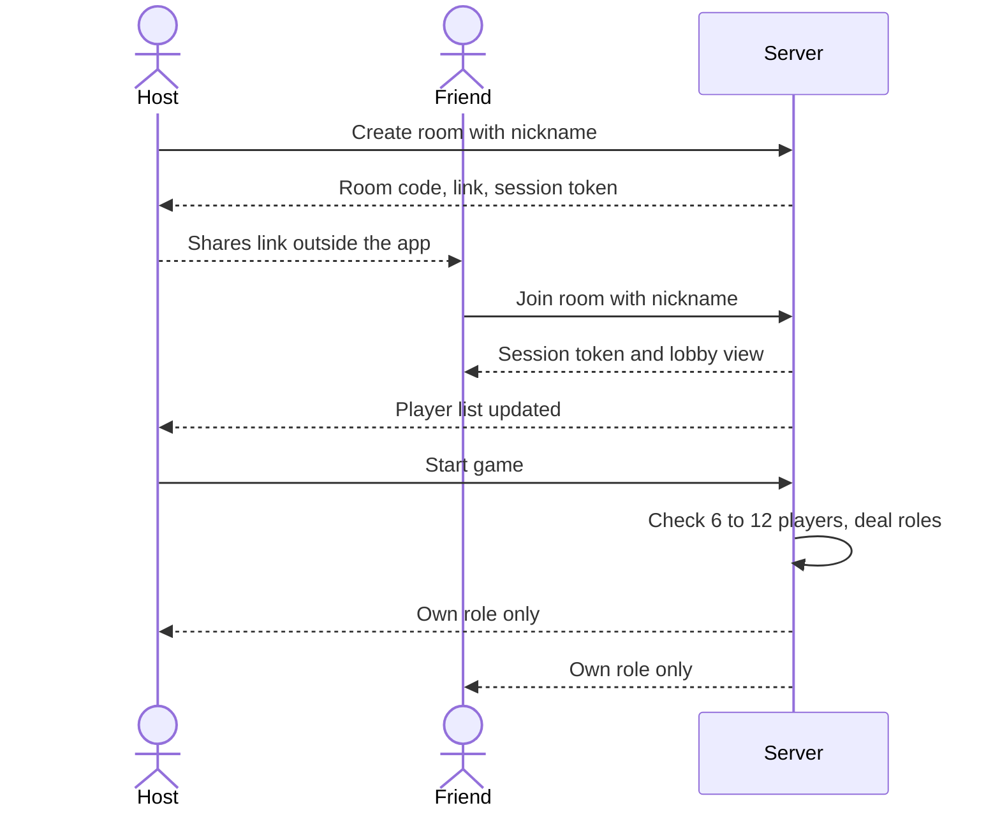
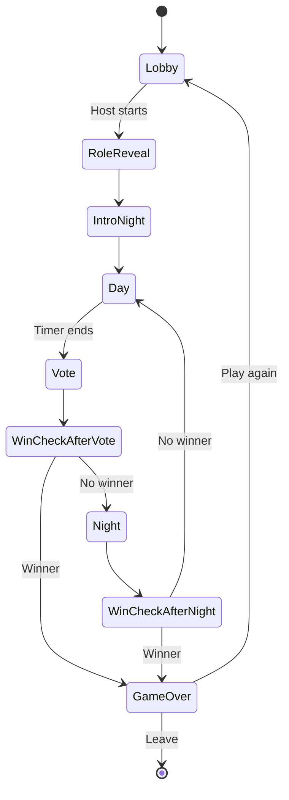
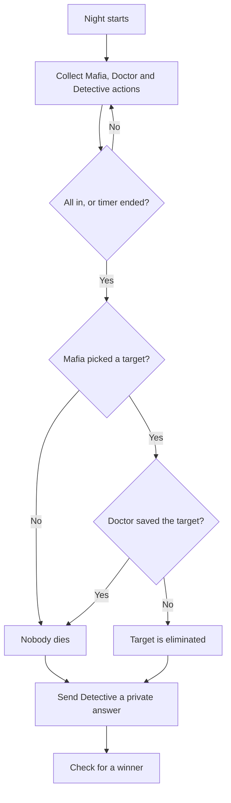
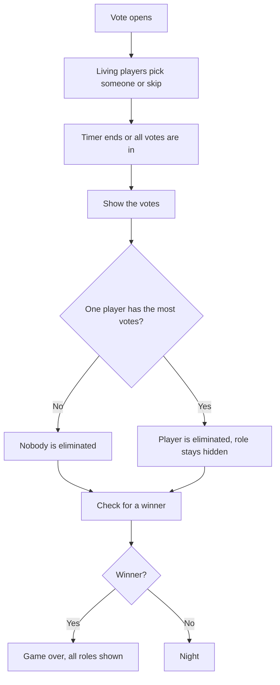
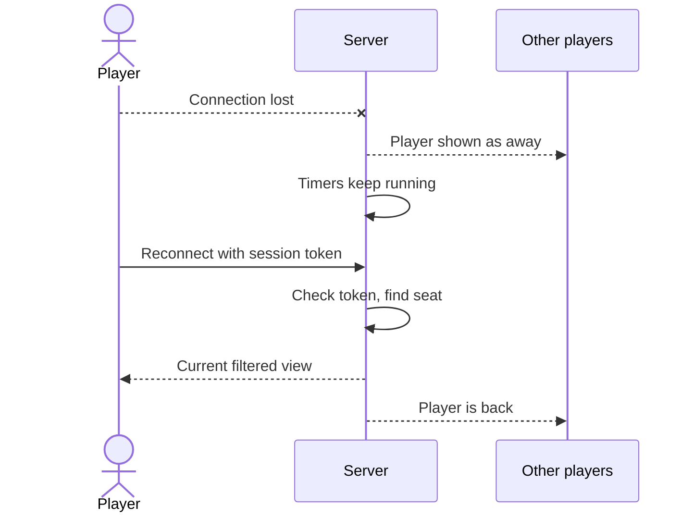
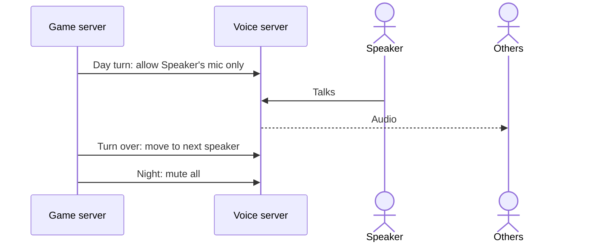
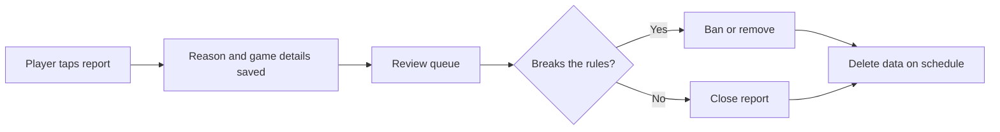

# Logical flow

The main flows, step by step. Flows 1 to 5 are built (v0.1). Flow 6 is built-in voice, which is not built yet: the server side runs against a local fake only.

## 1. Create a room and join

1. A player opens the site, picks a nickname and taps Create room.
2. The server makes a room with a short code and link. That player becomes the room host.
3. The host shares the link in any messaging app.
4. Friends open the link, pick a nickname and land in the lobby.
5. The host starts the game when 6 to 12 players are in. The host can remove someone before it starts.

## 2. The game loop

1. Each player sees only their own role. Mafia players also see their team.
2. First night is an introduction: the Mafia team meets and nobody is harmed.
3. Day: the app announces what happened, then players talk until the timer ends.
4. Vote: each living player picks someone or skips.
5. Night: roles act in secret.
6. After each night and each vote the app checks for a winner.

## 3. Night

1. Everyone sees the night screen. Living players with a role get their action.
2. The Mafia team talks in its private chat. The Godfather picks the target. If the Godfather is gone, the remaining Mafia picks.
3. The Doctor picks one person to save.
4. The Detective picks one person to check.
5. The night ends when all actions are in or the timer runs out. A missed action counts as no action.
6. The server works out the result. If the target was saved, nobody dies.
7. The Detective gets a private answer. The Godfather always reads as not Mafia.

## 4. Day and vote

1. The app announces who was eliminated, or that nobody was. It doesn't reveal roles or who saved whom.
2. Living players talk until the timer ends. Eliminated players can read but not write.
3. Living players vote in secret. Votes appear when everyone has voted or the timer ends.
4. The player with the most votes is eliminated. A tie, or skip having the most votes, means nobody goes.

Win checks:

- Citizens win when no Mafia players are left.
- Mafia wins when living Mafia players equal or outnumber everyone else.

## 5. Dropped connection

1. The browser keeps a session token.
2. If the connection drops, the player shows as away and the game carries on.
3. On return, the token restores their seat and the server sends the current view.
4. If they miss their action, it counts as no action. If they miss a vote, it counts as a skip.
5. After two missed phases in a row they're marked absent and stay in the game as someone who can be voted out. Mafia's win check still counts them.
6. If the room host is gone, the host role passes to the next player. The app runs the game, so play doesn't stop.

## 6. Voice (Phase 6)

1. When the game starts, the server creates one voice room and gives each player a token.
2. The server decides who can talk, so hiding a mic button isn't what protects the game.
3. By day, players speak in turn with a timer. Then there's a short open discussion.
4. At night every mic is off and the Mafia team uses its text chat.
5. Eliminated players can listen but not speak.
6. If voice can't connect, the player stays in with text and sees a clear message.
7. Audio is never recorded.

## 7. Report and block (before the public test)

1. Any player can report another from the player list, with a reason.
2. The report saves the nickname, room, time and recent chat from that game, so it's kept after chat would normally be deleted.
3. Blocking hides that player's chat for the person who blocked them.
4. A person reviews reports and can ban a session or remove content.
5. Report data is deleted after review, on a fixed schedule.

